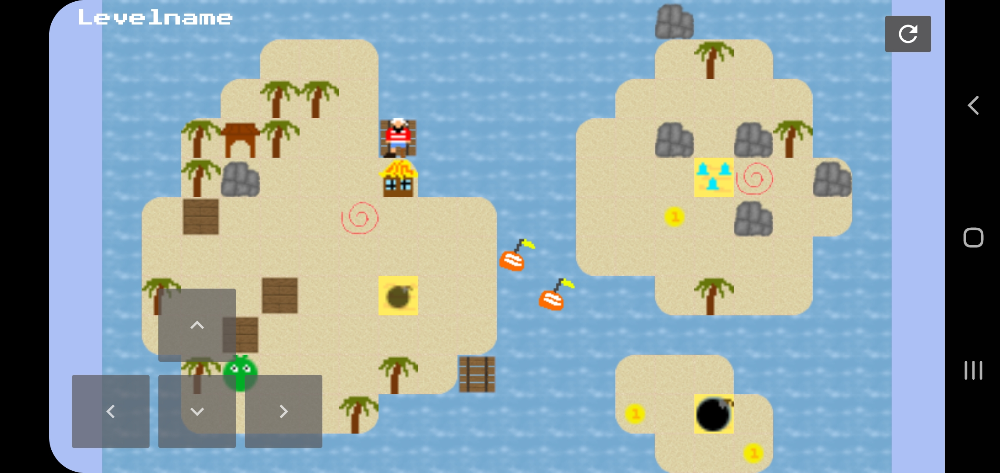
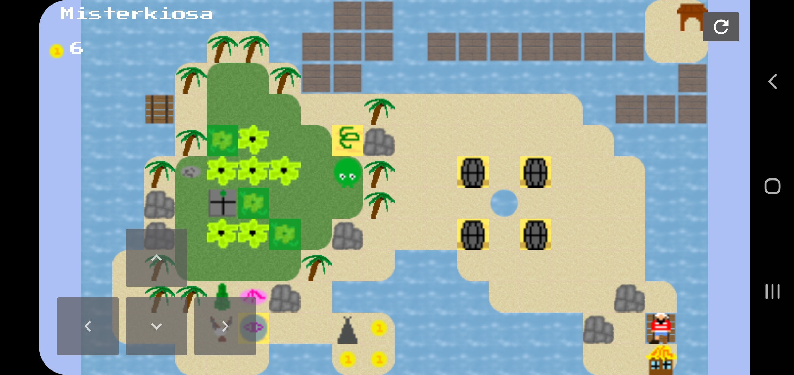
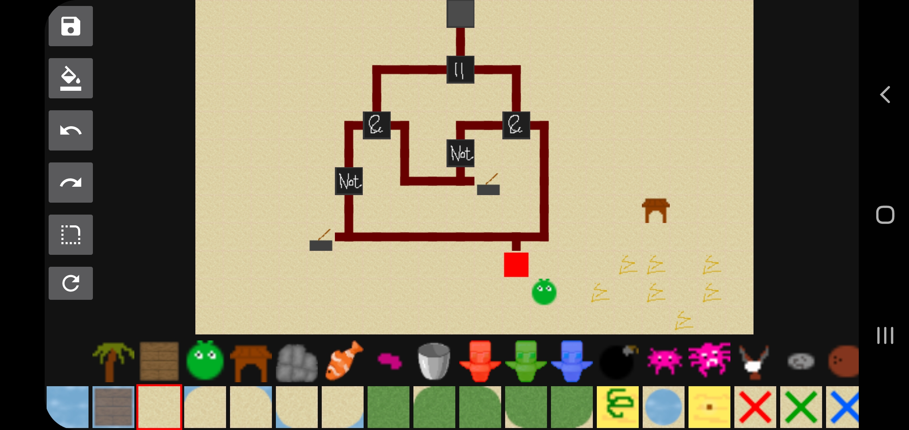

# Pushy-Island

> [!NOTE]
> Disclaimer: Based on the game _Pushy Island_ from <a href="http://www.lws9.de/">Lernwerkstatt</a>. No original code was used.

## Screenshots






## Features

### New entities not available in the original game

I implemented all entities from the original game. Additionally to that I added some new entities. They are mostly logic gates (AND / OR / XOR / NOT), levers, buttons, repeaters and lamps.

### Campaign

All original levels can be played in the game. Additionally I added some new levels with my new entities to the campaign. Levels unlock one after another.

### Editor

With the in-app editor (and the [web level editor](#web-level-editor)) you can create your own levels:

- pencil (drag to paint), fill and erase
- undo / redo
- auto smoothing of sand and grass corners
- reset

After you validated your level by solving it on your own, you can share it: the app creates a share code (`PUSHY2:…`) that your friends can paste into _Custom levels → Import code_.

## Project layout

| Folder          | What it is                                                                                     |
| --------------- | ---------------------------------------------------------------------------------------------- |
| `engine/`       | Pure Kotlin game engine (no Android): rules, level format, share codes, editor logic, tests    |
| `app/`          | Android app – Jetpack Compose, Navigation 3, Room. Campaign levels and sprites live in `assets` |
| `level-editor/` | Web level editor (React + TypeScript + Vite) and the converter for levels of the old app       |
| `level-format/` | Format documentation, the shared tile table (`tiles.json`) and cross-platform test fixtures    |

## Building

Requirements: JDK 17+ (Android Studio's bundled JDK works), Android SDK with platform 37, Node.js 24+ for the web editor.

```sh
./gradlew :engine:test          # engine tests, incl. loading all 186 campaign levels
./gradlew :app:assembleDebug    # build the app
./gradlew :app:lintDebug
```

`level-format/tiles.json` is generated from the engine. After changing tiles in
`engine/.../model/TileType.kt` regenerate it (and the share code fixture) with
`UPDATE_GENERATED=1 ./gradlew :engine:test`.

## Web level editor

```sh
cd level-editor
npm install
npm run dev           # editor on http://localhost:5173
npm test              # format, share code and editor tests
npm run lint          # oxlint
npm run format        # oxfmt (npm run format:check in CI)
npm run build         # static build in level-editor/dist
```

The web editor uses the same sprites as the app (`app/src/main/assets/sprites`) and reads/writes the same
level files and share codes. It also imports share codes of the old app.

## Level format

Levels are stored as readable JSON (format v2) – see [level-format/README.md](./level-format/README.md).
Campaign levels are in [`app/src/main/assets/levels`](./app/src/main/assets/levels).

### Levels from the old app

The old app used a hex "level code" (format v1). The web editor imports those codes directly. To convert
codes or a folder of the old level JSON files on the command line:

```sh
cd level-editor
node scripts/convert-v1.ts <v1 code>
node scripts/convert-v1.ts --campaign <old level folder> <output folder>
```
