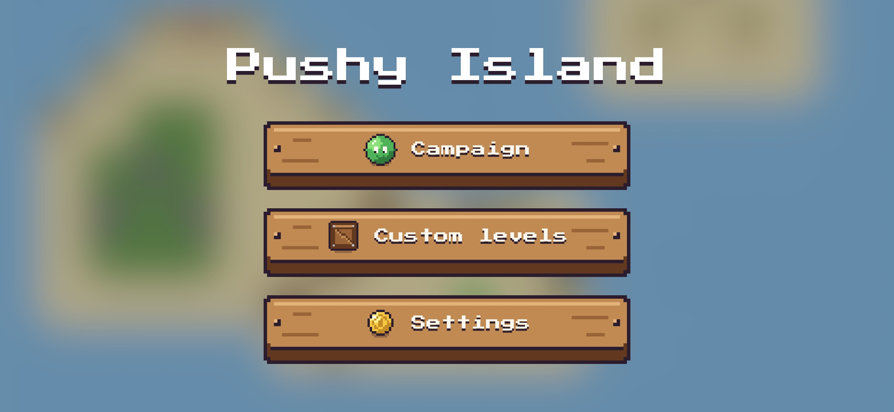
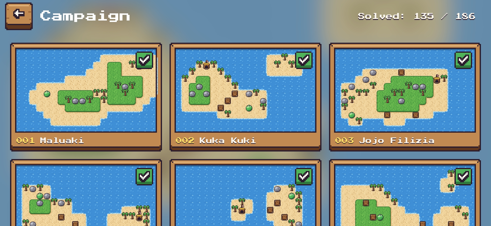
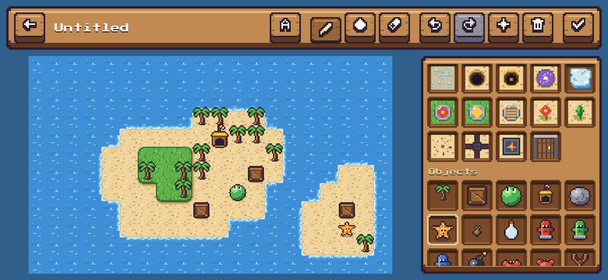
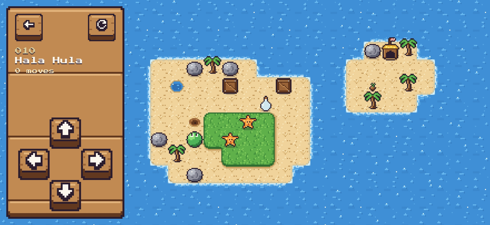
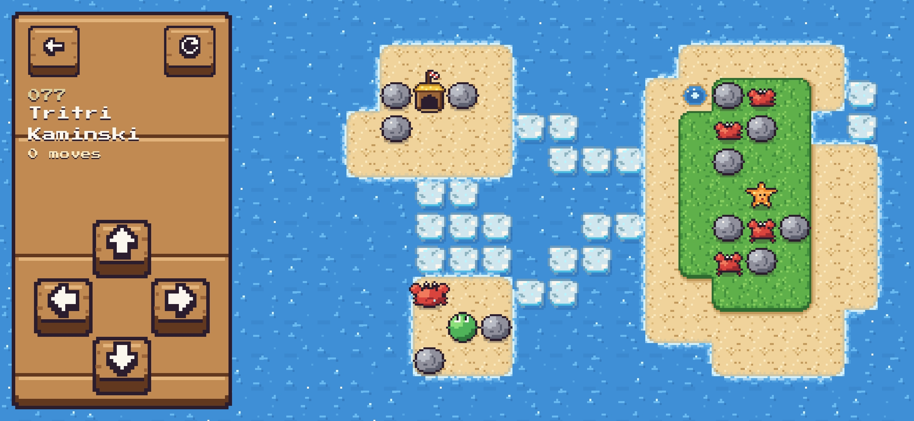

# Pushy Island

> [!NOTE]
> Disclaimer: Based on the game _Pushy Island_ from <a href="http://www.lws9.de/">Lernwerkstatt</a>. No original code was used.

A pixel-art puzzle game for Android: push boxes, sail boats, wire up logic gates and help Pushy find his way home.



## Screenshots

| Campaign                              | Editor                            |
| ------------------------------------- | --------------------------------- |
|     |     |
|  |  |

## Features

- A campaign with all levels of the original game plus new levels with logic puzzles. Levels unlock one
  after another.
- Every object from the original (boxes, boats, statues, slingshots, pirates, crabs, octopuses, …) plus new
  logic tiles: AND / OR / XOR / NOT gates, levers, buttons, repeaters, lamps and doors.
- Animated pixel art drawn by code in one palette, with waves, boat wakes, explosions and confetti.
- Synthesised chiptune sound effects, which can be switched off in the settings.
- A level editor with pencil, fill, erase, undo / redo and automatic corner smoothing. After solving your
  level you can share it as a code (`PUSHY2:…`) that friends paste into _Custom levels → Import code_.

## Documentation

See [docs](./docs/README.md):

- [How to play](./docs/how-to-play.md)
- [Tiles](./docs/tiles.md) – what every tile and object does
- [Level format](./docs/level-format/README.md) – level files and share codes
- [Development](./docs/development.md) – building, tests, sprites and sounds

## Quick start

Requirements: JDK 17+ (Android Studio's bundled JDK works), Android SDK with platform 37, Node.js 24+ for the
web editor.

```sh
./gradlew :engine:test          # engine tests, incl. loading all campaign levels
./gradlew :app:assembleDebug    # build the app

cd editor && npm install && npm run dev   # web editor on http://localhost:5173
```

| Folder          | What it is                                                                   |
| --------------- | ---------------------------------------------------------------------------- |
| `engine/`       | Pure Kotlin game engine (no Android): rules, level format, share codes, tests |
| `app/`          | Android app – Jetpack Compose, Navigation 3, Room                            |
| `editor/`       | Web level editor (React + TypeScript + Vite)                                 |
| `tools/`        | Scripts that draw the sprites and synthesise the sounds                      |
| `docs/`         | Documentation, incl. the level format with its tile table and test fixtures  |
