# Tiles

Every level has two layers: **terrain** (the ground) and **objects** standing on it. The id below each name
is the one used in [level files](./level-format/README.md). Tiles marked _max. n_ may only appear that often in a level.

A level is solved when Pushy walks into the hut and every **task** is done.

# Terrain

## Ground

| | Tile | What it does |
| --- | --- | --- |
|  | **Sand** `sand` | Normal ground. |
|  | **Grass** `grass` | Higher ground. Pushy can jump down to sand but not climb up. Flowers grow on grass. |
| 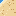 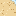  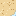 | **Sand corners** `sand_top_left`, `sand_top_right`, `sand_bottom_left`, `sand_bottom_right` | Rounded sand, otherwise like sand. The editors can set them automatically (_Smooth corners_). |
| 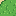 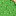 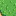 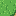 | **Grass corners** `grass_top_left`, `grass_top_right`, `grass_bottom_left`, `grass_bottom_right` | Rounded grass, otherwise like grass. |
|  | **Water** `water` | Pushy can't walk on water. Boxes sink into it, sea stars swim away. |
|  | **Sunken box** `box_water` | A box that was pushed into the water. Pushy can walk over it. |
|  | **Ice** `ice` | Can be walked on once: as soon as something stood on it and left, it melts into water. |
|  | **Hole** `hole` | Nothing gets past it until it is filled – by a rolling coconut or by the coconut tunnels. |

## Water and travel

| | Tile | What it does |
| --- | --- | --- |
| 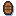 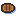 | **Boat** `boat` | Pushy steps onto the boat and walks towards the water: the boat sails in that direction until the next field is no free water. Its bow turns where it sailed. |
|  | **Vine** `spring` | A springy vine that grows where a full bottle waters a planted farm. Throws Pushy one field further in the direction he walked onto it. |
|  | **Teleporter** `teleporter` | _max. 2_ – Beams Pushy to the other teleporter. |
| 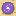 | **Item teleporter** `item_teleporter` | _max. 2_ – Beams anything that is pushed or walks onto it to the other item teleporter. |
| 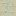 | **Invisible bridge** `water_invisible` | Looks like water while one of its plates is free, but can always be walked on – the plates just make the path visible. |
|  | **Bridge plate** `water_invisible_pressure_plate` | While something stands on every bridge plate, the invisible bridges show up as ground. |

## Plates and goals

| | Tile | What it does |
| --- | --- | --- |
|  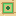  | **Statue plates** `statue_finish_red`, `statue_finish_green`, `statue_finish_blue` | The statue of the same color has to stand here. |
| 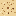 | **Barrel plate** `barrel_finish` | A barrel has to stand here. |
|   | **Flower plates** `flower_red_pressure_plate`, `flower_yellow_pressure_plate` | **Task:** a flower of the same color has to grow on it. Grass. |
|  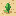 | **Flower beds** `changeable_flower_red`, `changeable_flower_green` | **Task:** all flower beds must have the same color. Flipped with the string plates. |
|  | **String plate** `string_pressure_plate` | The first string plate Pushy steps on makes him lay a string behind him; the second one flips the color of every flower bed under the string. Each plate works once. |
|  | **Bomb trigger** `bomb_field` | When Pushy steps on it, every bomb explodes. |
| 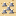 | **Spikes** `spikes` | Block the way while at least one spike plate is free. They stay down while something stands on them. |
|  | **Spike plate** `spike_pressure_plate` | Cover all spike plates to pull the spikes in. |

## Farming and coconuts

| | Tile | What it does |
| --- | --- | --- |
| 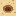 | **Farm** `farm` | Pushy plants a seed from his inventory when he walks over it. |
|  | **Water hole** `water_hole` | Fills bottles pushed onto it. Octopuses brought here go home. |
| 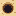 | **Coconut tunnel** `coconut_tunnel` | Coconuts roll through tunnels; a coconut inside a tunnel can only roll on to tunnel fields. |
| 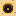 | **Tunnel end** `coconut_tunnel_finish` | When every tunnel end holds a coconut, all holes of the level get filled. |

## Logic

Logic tiles carry signals. Gates switch 0.3 s after their inputs change.

| | Tile | What it does |
| --- | --- | --- |
| 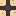 | **Cable** `cable` | Carries a signal between logic parts and glows while active. Connects to neighbouring cables and ports automatically. |
| 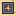 | **Logic plate** `logic_pressure_plate` | Sends a signal while something stands on it. |
| 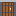 | **Door** `door` | Blocks the way; opens while a signal arrives from any side. |

# Objects

## Pushy and the hut

| | Tile | What it does |
| --- | --- | --- |
| 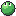 | **Pushy** `pushy` | _max. 1_ – That's you. |
| 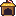 | **Hut** `finish` | _max. 1_ – Walk into it from the south to finish the level once every task is done. |

## Obstacles

| | Tile | What it does |
| --- | --- | --- |
| 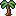 | **Palm tree** `tree` | Blocks the way. A slingshot stone hitting it drops a coconut behind it (on sand). |
| 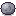 | **Rock** `stone` | Blocks the way and slingshot stones. Bombs blow it up. |
|  | **Buoy** `buoy` | Blocks the way, usually on water. |
| 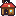 | **Pirate hut** `pirate_hut` | _max. 1_ – Blocks the way. |

## Things to push

| | Tile | What it does |
| --- | --- | --- |
| 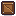 | **Box** `box` | Can be pushed. Sinks into water and becomes a bridge. |
| 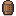 | **Barrel** `barrel` | **Task:** every barrel has to stand on a barrel plate. |
| 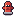 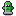 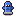 | **Statues** `statue_red`, `statue_green`, `statue_blue` | Pushing one statue moves **all** statues of its color in that direction. **Task:** each statue has to stand on its plate. |
| 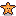 | **Sea star** `sea_star` | **Task:** push every sea star back into the water. |
| 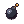 | **Bomb** `bomb` | Can be pushed. Explodes when Pushy steps on a bomb trigger and destroys rocks next to it. |
| 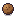 | **Coconut** `coconut` | Rolls until it hits something. Fills the first hole it rolls into. |
|  | **Bottle** `bottle` | Gets filled on a water hole. A full bottle pushed onto a planted farm makes a springy vine grow there. |
| 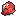 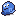 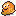 | **Mood shells** `shell_1`, `shell_2`, `shell_3` | Get happier with every push (1 → 2 → 3 → 1 …). **Task:** every mood shell has to be happy (3). |
|      | **Number blocks** `count_one`, `count_two`, `count_three`, `count_four`, `count_five` | _max. 1 each_ – Start hidden. Pushing one uncovers it. Uncover them in order 1, 2, 3, … – a wrong one hides all of them again. **Task:** uncover all of them. |
|   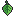  | **Leaves** `leaf_up`, `leaf_right`, `leaf_down`, `leaf_left` | Can be pushed. Redirect slingshot stones that fly over them. |

## Things that react

Pushy doesn't push these – he walks against them.

| | Tile | What it does |
| --- | --- | --- |
| 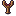 | **Slingshot** `slingshot` | From the south, with a stone in the inventory: fires the stone north. It flies until it hits something (see leaves, trees, shells). |
|     | **Leaf turner** `leaf_changer_north`, `leaf_changer_east`, `leaf_changer_south`, `leaf_changer_west` | Turns every leaf of the level into the direction Pushy walked against it. |
|   | **Flowers** `flower_red`, `flower_yellow` | Grow flowers of their color across the grass in the direction Pushy walked against them, until something is in the way. |
| 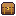 | **Chest** `chest` | From the south, with a key: opens and gives a coin. |
| 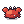 | **Crab mother** `crab_mother` | _max. 1_ – From the south: takes the crab babies Pushy carries. **Task:** bring her all of them. |
| 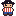 | **Pirate** `pirate` | _max. 1_ – From the west: takes Pushy's coins and leaves once he got all of them (one for every coin and every key of the level). **Task:** pay the pirate. |
|  | **Tower** `tower` | Walk against it with a pearl to light it. When every tower is lit, all of them disappear. |
|  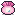 | **Shell** `shell`, `shell_open_with_pearl` | Closed shells can be pushed. A slingshot stone opens them; walk against an open shell to take its pearl. |
| 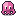 | **Octopus** `octopus` | Follows Pushy when it is right behind him and can't be pushed. **Task:** lead every octopus to a water hole. |

## Items

Picked up by walking onto them and used automatically.

| | Tile | What it does |
| --- | --- | --- |
|  | **Coin** `coin` | For the pirate. |
|  | **Key** `key` | Opens a chest. |
| 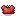 | **Crab baby** `crab_baby` | For the crab mother. |
| 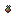 | **Seed** `seed` | Planted on a farm. |
|  | **Stone** `shot` | Ammunition for the slingshot. |
| 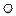 | **Pearl** `pearl` | Lights a tower. |
|  | **Energy** `energy` | Pays for one lever pull or button press. |

## Logic objects

Logic objects show their inputs and outputs as small marks on their sides.

| | Tile | What it does |
| --- | --- | --- |
| 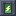 | **Power block** `power_block` | Can be pushed. Always sends a signal to all sides. |
|  | **Lever** `lever` | Costs one energy to flip. Sends a signal to all sides while it is on. |
|  | **Button** `button` | Costs one energy to press. Sends a signal for about a second. |
| 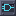 | **AND gate** `logic_gate_and` | Inputs west and east, output north: on while **both** inputs are on. |
| 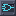 | **OR gate** `logic_gate_or` | Inputs west and east, output north: on while **at least one** input is on. |
|  | **XOR gate** `logic_gate_xor` | Inputs west and east, output north: on while **exactly one** input is on. |
|  | **NOT gate** `logic_gate_not` | Input south, output north: on while the input is **off**. |
|     | **Repeater** `repeater_north`, `repeater_east`, `repeater_south`, `repeater_west` | Can be pushed. Passes a signal on in one direction only – the direction it was last pushed. |
|  | **Lamp** `lamp` | Lights up while a signal arrives from any side. **Task:** every lamp has to be lit. |
|  | **Countdown lamp** `count_down` | Counts down 3 → 0, one step for every new signal, and then stays lit. **Task:** like a lamp. |
